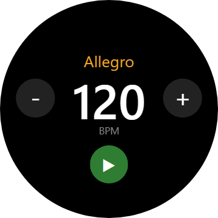
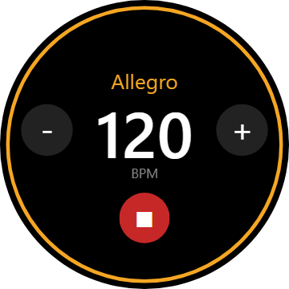

# Simple Metronome

Metrônomo por vibração para o Amazfit GTR 3 Pro (Zepp OS 1.0). A cada batida o relógio vibra e um anel laranja pisca, para estudar sem olhar para o pulso.




## Recursos

- 30 a 250 BPM, pela coroa ou pelos botões − e + (segure para correr)
- Nome do andamento na tela, de Grave a Prestissimo
- Batida estável: o atraso não se acumula
- Abre no último BPM usado
- Tela acesa enquanto toca
- Sem internet, sem sensores e sem permissões

## Limitação

Levantar o braço apaga a tela e pausa a batida, e o Zepp OS 1.0 não deixa apps impedirem isso. Deixe "Levantar o pulso para ativar" ligado: ao olhar o relógio de novo, o metrônomo volta sozinho.

## Desenvolvimento

Requer Node.js 22 e o [Zeus CLI](https://docs.zepp.com/docs/guides/tools/cli/).

```sh
npm i -g @zeppos/zeus-cli
zeus build                       # gera o pacote em dist/
zeus preview                     # instala no relógio por QR code
node --test test/metronomo.test.js
```

O `zeus preview` precisa de uma conta de desenvolvedor Zepp e do modo desenvolvedor no app Zepp. O simulador não vibra, então a batida só pode ser conferida no relógio.

## Estrutura

- `page/index.js`: tela e ligação com o relógio
- `utils/metronomo.js`: lógica pura, sem API do relógio
- `test/`: testes da lógica
- `scripts/gerar-icone.js`: gera o ícone
- `publicacao/`: textos e imagens da loja

## Licença

[MIT](LICENSE)
